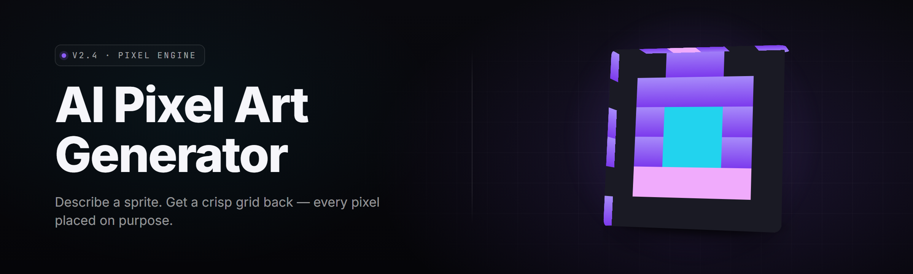

  
  
  

  

  
  
  

---

---

### 📋 Requirements

Before you download, check that your machine meets the bar. PixelBrew 2026 runs on Windows 10 (build 19041+) or Windows 11. GPU acceleration wants a Vulkan 1.3 or CUDA 12-capable card with 6 GB VRAM for the diffusion stage; CPU fallback works but you'll feel it on 512×512 batches. 16 GB RAM minimum, 32 GB recommended if you're running sprite sheets in parallel with the editor open. Storage: 4.2 GB installed, plus ~12 GB scratch for model weights and the LoRA cache. The `.exe` is self-contained — no Python, no pip, no Node, no git.

---

## 🧭 Table of Contents

- [Overview](#-overview)
- [What is PixelBrew](#-what-is-pixelbrew)
- [Key Features](#-key-features)
- [The Problem](#-the-problem)
- [The Solution](#-the-solution)
- [Quick Start](#-quick-start)
- [Comparison](#-comparison)
- [Module Status](#-module-status)
- [Catalog A — Palette &amp; Style Engines](#-catalog-a--palette--style-engines)
- [Catalog B — Sprite &amp; Tile Synthesis](#-catalog-b--sprite--tile-synthesis)
- [Catalog C — Animation &amp; Rigging](#-catalog-c--animation--rigging)
- [Catalog D — Workflow &amp; Export](#-catalog-d--workflow--export)
- [Known Issues](#-known-issues)
- [System Requirements](#-system-requirements)
- [Installation](#-installation)
- [FAQ](#-faq)
- [Tips for Best Results](#-tips-for-best-results)

---

## 🎨 Overview

| Category | Details |
|---|---|
| Product | PixelBrew 2026 — AI pixel-art generator |
| Version | v2.4.1 (main branch, tested) |
| Platform | Windows 10 / 11 x64, standalone `.exe` |
| Backend | Local diffusion + palette-constrained sampler |
| Model pack | 8 style LoRAs bundled, 14 downloadable |
| Output | PNG sprite sheets, GIF, APNG, Aseprite, Godot `.tres` |
| Integration | Aseprite, Godot, Unity PNG import, Tiled `.tsx` |
| Licensing | MIT for the app, CC-BY-4.0 for bundled palettes |

PixelBrew is a desktop AI pixel-art generator that turns a text prompt, a reference image, or an existing sprite into palette-locked pixel art at 16×16 through 256×256 resolutions. I built it because every diffusion tool on the market treats pixel art as a style transfer gimmick — you get blurry 512×512 output that "looks pixel-ish" and then you spend forty minutes cleaning it in Aseprite. PixelBrew bakes the pixel grid into the sampler itself.

---

## 🧪 What is PixelBrew

| Term | Explanation |
|---|---|
| Palette-locked sampling | The diffusion process is constrained to a user-defined or bundled palette (e.g. DB16, PICO-8, NES, Endesga-32) so no stray anti-aliased pixels ever appear. |
| Grid-aware denoiser | A custom scheduler that quantizes the latent during step-out, snapping features to integer pixel positions. |
| Sprite sheet assembly | Automatic row/column packing of directional frames (N/S/E/W) into standard RPG Maker, Godot, or Tiled layouts. |
| LoRA | Low-rank adaptation — a small style weight file (30–200 MB) that steers the base model toward a specific aesthetic (GB Studio, C64, isometric, etc.). |
| Reference conditioning | IP-Adapter-style pipeline that takes a sketch or photo and preserves silhouette + palette regions. |
| Tileable mode | Seam-less edge stitching for terrain tiles — the prompt generates a 3×3 grid and only the center tile ships. |
| Frame interpolation | Between two keyframe sprites, PixelBrew generates 2–8 in-between frames using a pixel-aware optical flow pass. |

**Why people land on PixelBrew:**

- You stop fighting anti-aliasing in post — the grid is enforced at generation time.
- Palette swapping is instant. One click, whole sheet recolors, zero quality loss.
- Animation in-betweens are honest pixel interpolation, not smeared vector blending.
- The `.exe` runs offline. No API keys, no rate limits, no telemetry.

---

## 🧩 Key Features

| Feature | Description | Benefit |
|---|---|---|
| Palette Lock v2 | 32 bundled palettes + custom import from `.gpl` / `.hex` / `.png` | Guaranteed palette compliance |
| Tile Seam Solver | Edge-stitching pass with mirrored + offset sampling | Terrain that tiles cleanly |
| Directional Sprite Forge | 1 prompt → 4-way or 8-way directional set | Full RPG character in one click |
| Aseprite Bridge | Round-trip `.aseprite` files via CLI hook | Edit → regenerate → re-edit loop |
| LoRA Stack UI | Chain up to 3 style LoRAs with weight sliders | Blend "NES" + "handheld" + "dither-heavy" |
| Frame Interpolator | 2 keyframes → N in-betweens | Smooth walk cycles in seconds |
| Batch Queue | 200-prompt queue with palette randomization | Sprite sheet farms overnight |
| Tilemap Composer | Paint tiles onto a grid, export Tiled `.tmx` | Level-blockout helper |
| Inpaint Brush | Mask region + prompt local fix | Fix a bad hand without rerolling the sprite |
| Reference Adapter | Sketch/photo → silhouette-preserving pixel | Convert concept art |
| Diff View | Side-by-side of last 10 generations | Pick the one that landed |
| Export Presets | Godot / Unity / RPG Maker / Aseprite | Zero-friction pipeline drop-in |

---

## 💢 The Problem

- Every "AI pixel art" tool on the market outputs **512×512 mush** and calls it pixel art.
- Palette drift: you ask for DB16 and get 47 shades of orange.
- Animation is ignored — you get one static sprite, then you're on your own for walk cycles.
- Tile seams are visible. Terrain looks like refrigerator magnets.
- Existing tools upload your sprite to a cloud API. You don't own the output.
- Post-processing in Aseprite takes longer than drawing the sprite by hand would have.
- Style LoRAs are scattered across Discord servers with no versioning, no metadata, no checksums.

---

## 🧯 The Solution

| Problem | Solution |
|---|---|
| Blurry 512×512 output | Pixel-native sampler with grid-aware denoise |
| Palette drift | Palette Lock v2 constrains the latent at every step |
| No animation | Frame Interpolator + Directional Forge generate full cycles |
| Visible tile seams | Tile Seam Solver with mirrored sampling at borders |
| Cloud APIs | 100% local inference, offline `.exe` |
| Long post-process | Aseprite Bridge + export presets eliminate manual cleanup |
| Scattered LoRAs | Bundled pack with SHA-256 verified downloads |

---

## ⚙️ Quick Start

**1️⃣ Download the package** — grab the `.exe` from the project landing page. One file, no installer wizard.

**2️⃣ Extract** — right-click → Extract All. Pick a folder with space (4 GB minimum) *and* a short path. `C:\PixelBrew` beats `C:\Users\you\Downloads\stuff\New folder (3)` every time.

**3️⃣ First launch** — double-click `.exe`. Windows will flag it, click **More info → Run anyway** (this is an unsigned hobby build; the source is on the repo).

**4️⃣ Model pack loads** — first run extracts ~3.8 GB of weights to `%LOCALAPPDATA%\PixelBrew\models`. Takes 2–5 minutes on SSD. You get 8 LoRAs by default.

**5️⃣ Prompt and go** — type a prompt, pick a palette from the dropdown, hit Generate. First sprite lands in ~4 seconds on a 3060, ~18s on CPU.

  

---

## ⚖️ Comparison

| Aspect | Generic Diffusion Tool | Online AI Pixel Site | This Tool |
|---|---|---|---|
| Output resolution fidelity | 512×512, needs downscale | Cloud-locked | Native 16–256 px |
| Palette control | Prompt-only | Fixed presets | Palette Lock v2, 32 presets + custom |
| Animation support | None | None | Frame Interpolator + Directional Forge |
| Tile seam handling | Manual | Manual | Seam Solver pass |
| Offline capable | Sometimes | Never | Always |
| Cost | Free + GPU | Subscription | Free, MIT |
| Style LoRA ecosystem | Community, unverified | None | Bundled + SHA-verified pack |
| Aseprite round-trip | Manual | No | Native bridge |

---

## 📦 Module Status

| Module | Status | Description |
|---|---|---|
| Palette Lock v2 | ✅ Working | Constrained sampler, 32 presets |
| Tile Seam Solver | ✅ Working | Mirror + offset stitch pass |
| Directional Forge | ✅ Working | 4-way & 8-way sprite sets |
| Frame Interpolator | ✅ Working | 2–8 in-between frames |
| Aseprite Bridge | ✅ Working | `.aseprite` read/write via CLI |
| LoRA Stack UI | ✅ Working | Chain up to 3 LoRAs |
| Batch Queue | ✅ Working | 200-prompt overnight farm |
| Tilemap Composer | ✅ Working | Grid paint + Tiled export |
| Inpaint Brush | ✅ Working | Mask + local regeneration |
| Reference Adapter | ⚠️ Beta | Sketch → silhouette pipeline, flickers on high-contrast inputs |
| Diff View | ✅ Working | Last 10 generations side-by-side |
| Export Presets | ✅ Working | Godot / Unity / RPG Maker / Aseprite |

  

---

## 🎯 Catalog A — Palette &amp; Style Engines

**1. Palette Lock v2** — Constrains the diffusion latent to a user palette at every scheduler step. Supports RGB, indexed, and swap-table palettes. Custom palettes load from `.gpl`, `.hex`, or `.pal.png`.

**2. Palette Extractor** — Upload any reference image, get its dominant 8/16/32-color palette extracted into a reusable preset.

**3. Dither Engine** — Bayer, Floyd-Steinberg, Atkinson, and blue-noise dithering modes, all pixel-grid aware. Applied during denoise, not after.

**4. Style LoRA Stack** — Chain up to three LoRAs with independent weights. Blend "GB-Studio" + "C64" + "handheld-clean" and dial in the ratio live.

**5. Retro FX Pass** — Optional CRT scanline, subpixel simulation, and bloom for preview only (never baked into exported PNG unless you check the box).

**6. Color Ramps** — Auto-generate 5-step shading ramps (shadow / base / highlight alt / highlight / rim) from any base color.

**7. Palette Morph** — Between two palettes, generate intermediate color sets for palette-cycling animations.

**8. Aesthetic Classifier** — Labels your generated sprite's style (NES / SNES / GB / PICO-8 / modern-indie) so you know what you actually made.

---

## 🗡️ Catalog B — Sprite &amp; Tile Synthesis

**9. Directional Sprite Forge** — Single prompt → 4-way directional set (N/E/S/W) or 8-way for isometric. Character consistency locked via seed + embedding.

**10. Character Sheet Builder** — Combines directional sets into RPG Maker-format sheets (3×4, 4×4, custom).

**11. Tile Seam Solver** — Generates 3×3 grids and only ships the center — guaranteeing seamless tiling with neighboring tiles.

**12. Terrain Pack Mode** — One prompt → grass / dirt / sand / water variants, all sharing a coherent palette.

**13. Object Forge** — Props, items, inventory icons. Preset size classes: 16, 24, 32, 48.

**14. Item Card Mode** — Stylized item frames (border + icon + label) for RPG inventory UIs.

**15. UI Element Generator** — Buttons, panels, health bars, cursors — all palette-locked.

**16. Isometric Sprite Maker** — 2:1 iso projection with correct ground-plane anchoring.

**17. Silhouette Pass** — Generate pure-black silhouettes from a prompt for blocking.

---

## 🎞️ Catalog C — Animation &amp; Rigging

**18. Frame Interpolator** — Two keyframes, generate 2–8 honest pixel in-betweens via pixel-aware optical flow.

**19. Walk Cycle Preset** — Pre-tuned prompt templates for 4-frame and 8-frame walk cycles.

**20. Attack Sequence Builder** — Idle → anticipation → strike → recovery, all auto-timed.

**21. Idle Breath Loop** — Subtle 2-frame breathing loops for NPCs.

**22. Sprite Sheet Packer** — Automatic row/column packing with per-frame padding configurable.

**23. GIF / APNG Exporter** — Direct animated export with correct frame delays.

**24. Anchor Tool** — Set ground pivot point per frame so sprites don't jitter.

**25. Onion Skin** — Preview the previous frame as a translucent overlay while you edit.

---

## 🛠️ Catalog D — Workflow &amp; Export

**26. Aseprite Bridge** — Round-trips `.aseprite` files. Edits made in Aseprite re-open in PixelBrew with masks preserved.

**27. Godot Exporter** — `.png` + `.tres` SpriteFrames resource, drop into a Godot project.

**28. Unity Exporter** — Multi-slice sprite sheet with JSON metadata for the new sprite importer.

**29. RPG Maker MV/MZ Exporter** — Ready-made `$Actor.png` naming convention.

**30. Tiled Exporter** — `.tmx` + `.tsx` for level-blockout workflows.

**31. Batch Queue** — Queue 200 prompts, palette-randomize across them, walk away.

**32. Seed Bookmark** — Save seeds with tags. Repair a good generation later.

**33. Diff View** — Last 10 generations side-by-side with palette overlay.

**34. Inpaint Brush** — Mask region, prompt the fix, commit — no full reroll.

**35. Reference Adapter** — Sketch or photo → silhouette-preserving pixel sprite (Beta).

**36. Prompt History** — Searchable log of every prompt + params + output hash.

**37. Project Save** — `.pxbrew` file stores project state, prompts, palettes, and outputs.

**38. LoRA Installer** — Drag a `.safetensors` file in, checksum it, register it.

**39. Update Checker** — Silently pings the landing page for new version notes; never auto-downloads.

---

## 🩹 Known Issues

| Issue | Solution |
|---|---|
| First-generation stall on CPU-only machines | Expected — model warm-up takes 20–40 s. Subsequent gens are fast. |
| Aseprite Bridge fails if Aseprite path has spaces | Update the path setting in Preferences → External Tools; quoted path bug is fixed in v2.4.2 nightly. |
| Reference Adapter flickers on high-contrast line art | Lower the adapter weight to 0.4–0.6 in the LoRA panel. |
| Tilemap Composer exports upside-down in Tiled 1.10.x | Fixed in Tilemap Composer v1.3 — update from the bundled pack. |
| DLL load error on Windows 10 builds below 19041 | Upgrade Windows or run with `--cpu-only` flag. |
| CUDA 12.4 crashes on some 40-series drivers | Run `nvidia-smi` and roll back to 12.3 if driver < 552. |

---

## 🖥️ System Requirements

| Component | Minimum | Recommended |
|---|---|---|
| OS | Windows 10 build 19041 | Windows 11 22H2+ |
| CPU | 4-core x64 | 8-core x64 |
| RAM | 16 GB | 32 GB |
| GPU | Vulkan 1.3 (6 GB VRAM) | NVIDIA RTX 3060+ / CUDA 12 |
| Storage | 4.2 GB free (SSD) | 20 GB free NVMe for LoRA cache |
| Display | 1280×720 | 1920×1080+ |
| Runtime | none (self-contained .exe) | — |

---

## 📥 Installation

1. **Download the package from the project page.** One `.exe`, one zip with the bundled LoRA pack. No installer, no service, no background daemon.

2. **Extract to a short path.** `C:\PixelBrew` is ideal. Windows Defender may flag on first run — click **More info → Run anyway**, or add the folder to exclusions. Long paths and OneDrive-synced folders cause the Aseprite Bridge to misbehave.

3. **Run `.exe`.** First-launch unpacks model weights to `%LOCALAPPDATA%\PixelBrew`. Set your output folder in Preferences. Done.

---

## ❓ FAQ

<b>Does PixelBrew phone home or upload my sprites?</b>

No. Every inference runs on your GPU (or CPU). The update checker pings the landing page once at launch to fetch a version string — no data, no telemetry, no sprites. Disable it in Preferences → Network if you want a pure offline box.

<b>Why is the .exe flagged by Windows Defender?</b>

It's an unsigned hobby build. Code-signing certs cost $300+/year and this repo is MIT-licensed community software. Add the extract folder to Defender exclusions, or build the exe yourself from source — the build script is in `tools/build.ps1`.

<b>Can I use PixelBrew output in commercial games?</b>

Yes. The `.exe` is MIT. Bundled palettes are CC-BY-4.0 (credit appreciated, not required). Bundled LoRAs are CC-BY-4.0 unless the LoRA's `metadata.json` says otherwise — check the file before shipping.

<b>Does it work on AMD or Intel Arc GPUs?</b>

Yes, via the Vulkan backend. Performance is roughly 60–75% of an equivalent NVIDIA card for the same VRAM. CUDA-only features (some LoRA types) fall back to Vulkan-compatible equivalents.

<b>Where do LoRAs go?</b>

`%LOCALAPPDATA%\PixelBrew\loras\`. Drag a `.safetensors` file into the LoRA Stack panel and it auto-registers with a SHA-256 checksum. Broken or corrupt files are rejected before they hit the sampler.

<b>Can I generate a 4-way walk cycle from one prompt?</b>

Yes. Directional Sprite Forge → pick 4-way → enable Walk Cycle Preset → set frame count (4 or 8). One prompt produces the full sheet, animation frames anchored, export ready for RPG Maker MV/MZ out of the box.

<b>My tile seams look off. What's wrong?</b>

Check that Tile Seam Solver is enabled in the generation panel. Also verify the tile is being generated at the target output size, not at a preview size and later downscaled — the seam solver works on the final grid.

<b>How do I fix a bad hand on a sprite without rerolling?</b>

Inpaint Brush → paint over the hand → prompt `closed fist, 3 fingers visible, NES style` → commit. Only the masked region regenerates; the rest of the sprite stays byte-identical.

<b>LoRA stacking slows generation. Is that expected?</b>

Yes — each LoRA adds an inference pass on the cross-attention. Three LoRAs is roughly 1.9× the time of one. If you need speed, bake the stacked LoRA into a merged file via LoRA Installer → Merge &amp; Save.

<b>Will PixelBrew ever get a Linux or macOS build?</b>

Linux is on the roadmap for v2.5 (Vulkan backend is portable, the UI layer is the blocker). macOS is not planned — Metal backend is a rewrite I'm not committing to yet.

---

## 🧙 Tips for Best Results

- **Prompt like a brief, not a wish.** "16×16 NES knight, closed helmet, red plume, blue tunic, three-quarter view" beats "cool knight."
- **Lock the seed first, tweak the prompt second.** You learn which words do the heavy lifting.
- **Match palette to prompt.** Asking for "vibrant sunset colors" while running DB16 is a fight you'll lose.
- **Use Directional Forge for characters, Object Forge for props.** They use different conditioning paths and don't cross-pollinate well.
- **Enable Seam Solver for *every* tile.** Even when you think seams won't show, they show.
- **Batch with palette randomization off first.** Randomize on the second pass once the prompt is dialed in.
- **Export to Aseprite early.** PixelBrew is a sprinter, Aseprite is a marathon — use both.

---

PixelBrew 2026 is the tool I wanted when I started making pixel art a decade ago and kept hitting the wall of "this AI output is almost right but I have to rebuild it by hand." It ships tested on `main`, it runs offline, and the palette is the contract. If you find a bug, the issue tracker is open. If a LoRA misbehaves, checksum it and file it. The repo is MIT — fork it, break it, ship something beautiful with it.

